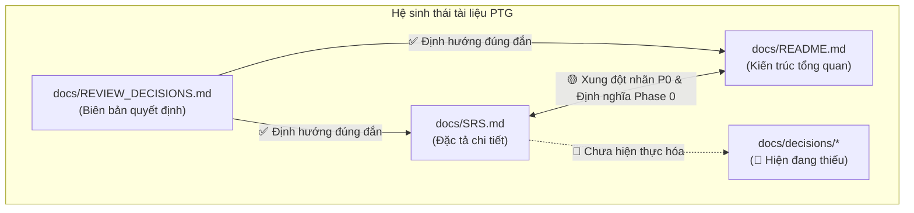
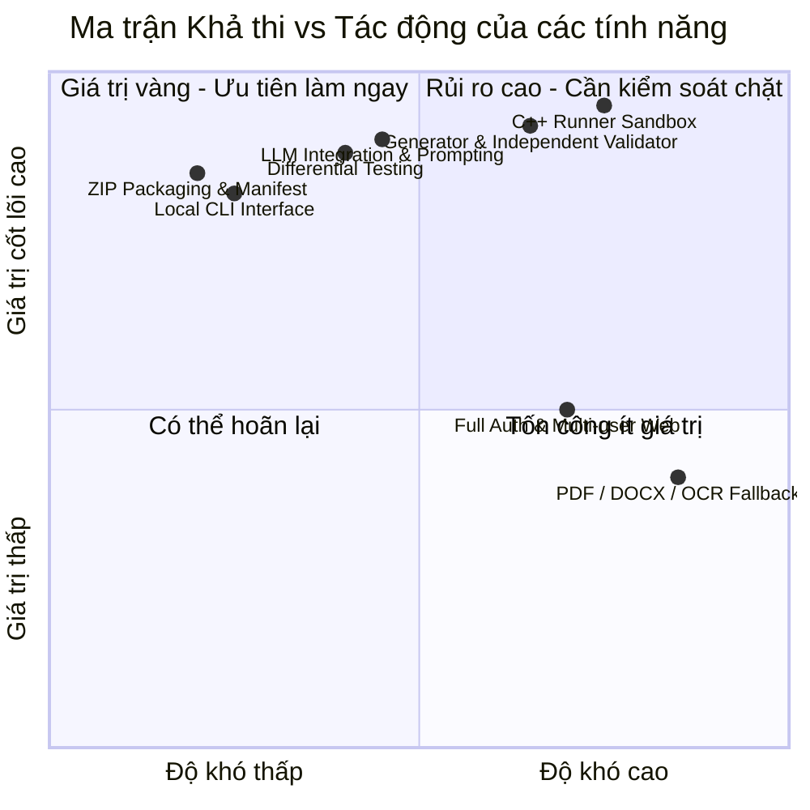
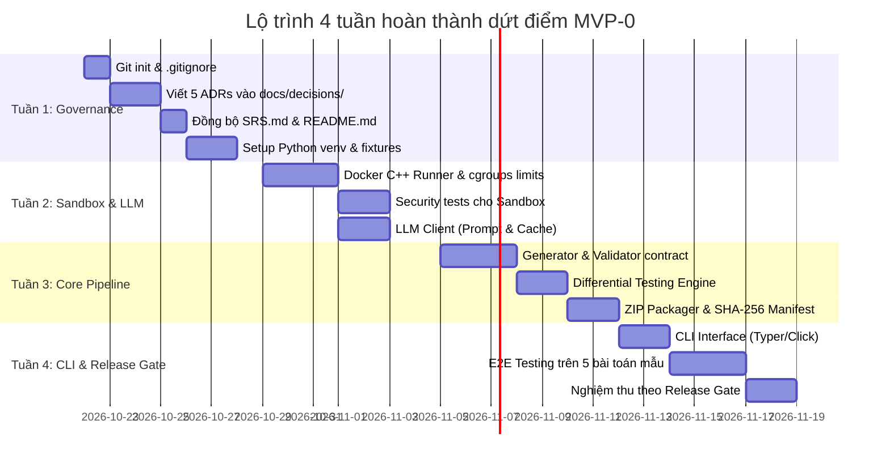

# BÁO CÁO REVIEW KỸ THUẬT TOÀN DIỆN (TECHNICAL AUDIT & ARCHITECTURE REVIEW)
> **Dự án:** Problem-to-Testcase Generator (PTG)  
> **Phiên bản tài liệu đánh giá:** Baseline v1.0 + Reconciliation Amendment (2026-10-21)  
> **Người thực hiện:** Principal Software Engineer & Software Architect (15+ years experience)  
> **Trạng thái:** Baseline Approved — Ready for Phase 0 (With Conditions)

---

## MỤC LỤC
1. [Executive Summary & Bảng điểm tổng thể](#1-executive-summary--bảng-điểm-tổng-thể)
2. [Bước 1: Kiểm kê toàn bộ dự án (Inventory)](#2-bước-1-kiểm-kê-toàn-bộ-dự-án-inventory)
3. [Bước 2: Đánh giá chi tiết từng tài liệu trong docs/](#3-bước-2-đánh-giá-chi-tiết-từng-tài-liệu-trong-docs)
4. [Bước 3: Đánh giá chéo tài liệu (Cross-Document Consistency)](#4-bước-3-đánh-giá-chéo-tài-liệu-cross-document-consistency)
5. [Bước 4: Đánh giá chuyên sâu theo 6 góc nhìn kỹ thuật](#5-bước-4-đánh-giá-chuyên-sâu-theo-6-góc-nhìn-kỹ-thuật)
6. [Bước 5: Phân tích khoảng trống (Gap Analysis)](#6-bước-5-phân-tích-khoảng-trống-gap-analysis)
7. [Bước 6: Tính khả thi & Khả năng mở rộng](#7-bước-6-tính-khả-thi--khả-năng-mở-rộng)
8. [Bước 7: Ma trận mâu thuẫn & Quản trị rủi ro](#8-bước-7-ma-trận-mâu-thuẫn--quản-trị-rủi-ro)
9. [Bước 8: Kế hoạch hành động & Roadmap theo tuần](#9-bước-8-kế-hoạch-hành-động--roadmap-theo-tuần)
10. [Bước 9: Kết luận, Lời khuyên & Định hướng CV](#10-bước-9-kết-luận-lời-khuyên--định-hướng-cv)

---

## 1. Executive Summary & Bảng điểm tổng thể

Dự án **Problem-to-Testcase Generator (PTG)** là một hệ thống web/CLI hỗ trợ giáo viên tin học và thí sinh thi lập trình chuyển đổi đề bài thuật toán thành mã giải C++17, bộ sinh testcase tự động, cơ chế kiểm định chéo (Differential Testing) và đóng gói file ZIP chuẩn thi đấu.

> [!NOTE]
> **Đánh giá sơ bộ:** Bộ tài liệu của PTG thuộc nhóm **top 5% xuất sắc nhất** ở quy mô solo developer. Dự án có tư duy phân tầng bảo mật (Defense-in-Depth) rất sâu sắc, dũng cảm loại bỏ các bẫy over-engineering (Microservices, Kafka, Polymorphic keys) và thiết lập nguyên lý kiểm thử trung thực (`PASSED_CHECKS` thay vì "đúng tuyệt đối").

### Scorecard tổng hợp

| Hạng mục đánh giá | Điểm số | Trạng thái | Tóm tắt nhận định |
|---|:---:|:---:|---|
| **Chất lượng tài liệu (Docs)** | **8.5/10** | 🟢 Tốt | Rất chi tiết, chuẩn mực RFC/IEEE, có revision amendment chất lượng cao. |
| **Kiến trúc hệ thống (Architecture)** | **8.5/10** | 🟢 Tốt | Modular Monolith + Background Workers chuẩn chỉ, ranh giới rõ ràng. |
| **Thiết kế an ninh (Security)** | **8.0/10** | 🟢 Tốt | Sandbox Docker kiểm soát cgroups, seccomp, no-net. Cần thêm limit compiler. |
| **Tính khả thi (Feasibility)** | **8.5/10** | 🟢 Rất cao | Khả thi tuyệt đối khi tách MVP-0 (CLI) làm trước trong 2-3 tuần. |
| **Khả năng mở rộng (Scalability)** | **8.5/10** | 🟢 Tốt | Stateless API và Worker queues dễ dàng scale ngang. |
| **Khả năng kiểm chứng (Testability)**| **8.5/10** | 🟢 Rất cao | Hợp đồng generator rõ ràng, tiêu chí nghiệm thu Release Gate cụ thể. |
| **Mức độ sẵn sàng cho Phase 0** | **7.5/10** | 🟡 Đạt (có đk) | Cần giải quyết 3 việc P0 trước khi viết code: Git, 5 ADRs, đồng bộ tài liệu. |
| **ĐIỂM TRUNG BÌNH CHUNG** | **8.3/10** | 🟢 **TỐT** | **ĐỦ ĐIỀU KIỆN TIẾN HÀNH PHASE 0 (CÓ ĐIỀU KIỆN)** |

---

## 2. Bước 1: Kiểm kê toàn bộ dự án (Inventory)

### 2.1 Cấu trúc vật lý
```text
D:\Dev\project\Testcase_Generator\
└── docs/
    ├── README.md               (29,363 bytes | 556 dòng)
    ├── REVIEW_DECISIONS.md      (1,701 bytes | 26 dòng)
    ├── SRS.md                  (100,305 bytes | 1,992 dòng)
    └── TECHNICAL_REVIEW_REPORT.md  (Báo cáo này)
```

### 2.2 Bảng kiểm kê chi tiết

| Đường dẫn tệp | Kích thước | Phân loại | Trạng thái | Cập nhật gần nhất | Đánh giá hiện trạng |
|---|---|---|---|---|---|
| `docs/SRS.md` | 1,992 dòng (98.0 KB) | SRS chính | **Đầy đủ** | 2026-10-21 | Bao phủ toàn bộ FR, NFR, ERD, API, NFR Sandbox, State Machine & Amendment. |
| `docs/README.md` | 556 dòng (28.7 KB) | Architecture Overview | **Đầy đủ** | 2026-10-11 | Giới thiệu hệ thống, sơ đồ khối, pipeline, bảng limits, roadmap phân kỳ. |
| `docs/REVIEW_DECISIONS.md` | 26 dòng (1.7 KB) | Executive Memo | **Đầy đủ** | 2026-10-11 | Biên bản thống nhất phạm vi từ đợt review trước (bác bỏ microservices/polymorphism). |
| `docs/decisions/` | *Chưa tồn tại* | Architecture Decisions | 🔴 **Thiếu** | N/A | Quy định bắt buộc 5 ADRs trước MVP-0 nhưng chưa được tạo. |
| `docs/api/` | *Chưa tồn tại* | API Contracts / OpenAPI | 🔴 **Thiếu** | N/A | Chưa có file schema `openapi.yaml` độc lập. |
| `docs/architecture/` | *Chưa tồn tại* | C4 Architecture Deep-dive | 🔴 **Thiếu** | N/A | Chưa có sơ đồ chi tiết C4 Level 2/3. |

---

## 3. Bước 2: Đánh giá chi tiết từng tài liệu trong docs/

### 3.1 Đánh giá `docs/REVIEW_DECISIONS.md`
- **Tóm tắt (3 dòng):** Tài liệu chốt hạ kết quả đợt review `PTG-REVIEW-001`. Khẳng định phân kỳ MVP-0/1/2, bảo vệ developer khỏi over-engineering (bỏ Kafka, Event Bus, UUIDv7, Polymorphic keys) và đính chính các quan niệm sai lầm về kiểm thử tự động.
- **Điểm chất lượng:** **8.0/10** (Clarity: 9/10, Completeness: 7/10, Feasibility: 9/10).
- **Vấn đề cụ thể:**
  - `[DOC-DEC-001] (🟢 Minor - Dòng 3)`: Ngày tháng 2026-10-11 lệch với bản sửa đổi SRS 2026-10-21. *Đề xuất:* Thêm metadata version sync.
  - `[DOC-DEC-002] (🟡 Major - Dòng 20)`: Nêu những thứ "không làm ở MVP-0" nhưng chưa nêu rõ deliverable thay thế. *Đề xuất:* Ghi rõ MVP-0 deliverable là Local CLI + JSON manifest.
- **Điểm mạnh:** Giúp developer tiết kiệm hàng tháng làm việc vô nghĩa; tư duy kiểm thử rất sắc bén.

---

### 3.2 Đánh giá `docs/README.md`
- **Tóm tắt (3 dòng):** Tài liệu nhập môn và kiến trúc tổng quan. Mô tả tech stack (React, FastAPI, PostgreSQL, Celery, Docker), pipeline xử lý 13 bước, cấu trúc thư mục logic và phần Amendment điều chỉnh sang MVP-0 CLI.
- **Điểm chất lượng:** **7.8/10** (Clarity: 8/10, Completeness: 8/10, Consistency: 6/10).
- **Vấn đề cụ thể:**
  - `[DOC-RD-001] (🔴 Critical - Dòng 333 vs 417)`: **Xung đột định nghĩa Phase 0.** Nửa trên yêu cầu dựng Postgres + Celery + FastAPI, nửa dưới (Amendment) yêu cầu chỉ làm Local CLI không DB, không Web. *Đề xuất:* Đổi tên Mục 12 thành "Lộ trình tương lai" và ghi chú rõ Phase 0 thực tế là MVP-0 CLI theo Amendment.
  - `[DOC-RD-002] (🟡 Major - Dòng 115-130)`: Sơ đồ Mermaid nối C++ Worker trực tiếp vào DB, vi phạm nguyên tắc cách ly mạng của untrusted code. *Đề xuất:* Tách C++ Worker ra khỏi mạng DB.
  - `[DOC-RD-003] (🟡 Major - Dòng 173-206)`: Cấu trúc thư mục chưa giải thích rõ 3 worker là 3 container riêng hay chung codebase Celery.
- **Điểm mạnh:** Hợp đồng C++ Generator chuẩn xác (`generator <seed> <subtask_id>`); nguyên tắc thiết kế trung thực ("không báo thành công giả").

---

### 3.3 Đánh giá `docs/SRS.md`
- **Tóm tắt (3 dòng):** Bản đặc tả kỹ thuật chi tiết nhất (gần 2000 dòng). Quy định 9 nhóm FR, 7 nhóm NFR, mô hình thực thể ERD, danh mục API, mô hình State Machine của Job, chiến lược kiểm thử và bộ quy tắc nghiệm thu Release Gate.
- **Điểm chất lượng:** **8.6/10** (Clarity: 8.5/10, Completeness: 9.5/10, Consistency: 6.5/10, Testability: 9/10).
- **Vấn đề cụ thể:**
  - `[DOC-SRS-001] (🔴 Critical - Mục 5 vs Mục A)`: **Xung đột độ ưu tiên (Priority Mismatch).** Auth (`FR-AUTH`), Upload (`FR-DOC`) vẫn để nhãn `P0` trong bảng Mục 5, nhưng Amendment Mục A đã hạ cấp xuống `P1` (chuyển sang MVP-1). *Đề xuất:* Sửa cột Priority ở Mục 5 thành `P1 (MVP-1)`.
  - `[DOC-SRS-002] (🟡 Major - Mục 8.1)`: Danh mục API thiếu endpoint compile và test độc lập cho `generator.cpp` và `validator.cpp`. *Đề xuất:* Bổ sung `/problems/{id}/generators` và `/validators`.
  - `[DOC-SRS-003] (🟡 Major - Dòng 1057)`: Mục 7.2 gợi ý index polymorphic `artifacts(owner_type, owner_id)` mâu thuẫn với nguyên tắc bác bỏ polymorphic keys ở Dòng 1948. *Đề xuất:* Thay bằng các khóa ngoại tường minh.
  - `[DOC-SRS-004] (🟢 Minor - Mục 11.1)`: Thiếu trạng thái `FAILED_INFRASTRUCTURE` và `APPROVED_FOR_EXPORT` trong bảng State Machine gốc.
- **Điểm mạnh:** Đặc tả an ninh Sandbox (NFR-SEC-05 đến 18) vô cùng tỉ mỉ; mô hình trạng thái xác minh `STALE` và `NEEDS_REVIEW` giải quyết hoàn hảo bài toán phụ thuộc dữ liệu.

---

## 4. Bước 3: Đánh giá chéo tài liệu (Cross-Document Consistency)



### Ma trận đối chiếu tính nhất quán

| Tài liệu A | Tài liệu B | Trạng thái | Điểm mâu thuẫn | Giải pháp chuẩn hóa |
|---|---|:---:|---|---|
| `SRS.md` (Mục 5) | `SRS.md` (Mục A) | 🔴 | Bảng Mục 5 ghi Auth/Doc là P0; Mục A ghi lùi sang MVP-1 (P1). | Cập nhật Mục 5: Thêm nhãn `P1 (MVP-1)` cho các mục lùi lại. |
| `README.md` (Mục 12) | `README.md` (Amend 1) | 🔴 | Mục 12 bắt đầu bằng Postgres/Celery/Web; Amend 1 chỉ làm CLI. | Thống nhất toàn dự án: Phase 0 = MVP-0 CLI Core Engine. |
| `SRS.md` (Mục 7.2) | `REVIEW_DECISIONS.md` | 🟡 | Gợi ý index `owner_type + owner_id` dù đã bị bác bỏ. | Bỏ index polymorphic, dùng standard foreign keys. |
| `README.md` (Mermaid) | `SRS.md` (NFR-SEC-07) | 🟡 | Sơ đồ Mermaid cho C++ Worker nối thẳng DB. | Sửa sơ đồ: C++ Worker nằm trong isolated network, không truy cập DB. |
| `SRS.md` (Mục H) | `docs/decisions/` | 🔴 | Yêu cầu 5 ADRs trước khi code nhưng thư mục chưa được tạo. | Khởi tạo thư mục và viết 5 file ADRs. |

---

## 5. Bước 4: Đánh giá chuyên sâu theo 6 góc nhìn kỹ thuật

---

### 5.1 Góc nhìn Software Architect
* **Điểm: 8.5/10**
* **Điểm mạnh:**
  - Lựa chọn **Modular Monolith + Background Workers** chuẩn xác 100% cho quy mô solo dev.
  - Phân định rõ ràng giữa I/O-bound (FastAPI API) và Heavy CPU-bound / Unsafe execution (Workers).
  - Tách bạch hoàn toàn Relational Metadata (Postgres) và File Blobs (Storage/Filesystem).
* **Điểm yếu & Mã vấn đề:**
  - `[ARC-001] (🔴 Critical)`: C++ Worker bị vẽ nối trực tiếp vào Postgres trên sơ đồ kiến trúc, phá vỡ ranh giới tin cậy (Trust Boundary).
  - `[ARC-002] (🟡 Major)`: Thiếu interface trừu tượng hóa cho Runner (`CodeRunnerInterface`) để chuyển đổi linh hoạt từ Docker sang `nsjail` hoặc `isolate`.
  - `[ARC-003] (🟡 Major)`: Worker cập nhật tiến độ từng testcase trực tiếp vào DB có nguy cơ gây write-amplification khi sinh 1000 testcases.
* **Khuyến nghị:** Viết class trừu tượng `CodeRunner`; tách C++ Worker khỏi network DB; gom batch cập nhật tiến độ (mỗi 10% hoặc 50 tests/lần).

---

### 5.2 Góc nhìn Security Engineer
* **Điểm: 8.0/10**
* **Điểm mạnh:**
  - Tư duy phòng thủ đa tầng (Defense-in-Depth): `--network=none`, `--read-only`, `--user=nobody`, drop `ALL` capabilities, `--security-opt=no-new-privileges`.
  - Không bao giờ thực thi mã C++ bên trong tiến trình API chính.
  - Chống lỗ hổng Path Traversal / Zip-slip trong khâu xuất và nén file ZIP.
* **Điểm yếu & Mã vấn đề:**
  - `[SEC-001] (🔴 Critical)`: **Thiếu limit thời gian và bộ nhớ cho khâu Biên dịch (Compiler Bomb).** C++ template đệ quy hoặc `#include </dev/urandom>` có thể làm treo CPU/RAM máy chủ biên dịch.
  - `[SEC-002] (🟡 Major)`: Thiếu cgroup `pids-limit` để chặn Fork Bomb (`std::thread` đệ quy).
  - `[SEC-003] (🟡 Major)`: Chưa có rate-limiting cụ thể cho các endpoint tốn tiền (LLM) và tốn CPU (Compile/Run).
* **Khuyến nghị:**
  - Lệnh compile bắt buộc bọc giới hạn cứng:  
    `timeout -s KILL 10s g++ -O2 -std=c++17 -fbracket-depth=256 -fmax-errors=3 ...`
  - Thêm cgroup flag: `--pids-limit=32`.
  - Tích hợp `slowapi` ở MVP-1 để rate-limit API theo IP và user ID.

---

### 5.3 Góc nhìn Data Engineer
* **Điểm: 7.5/10**
* **Điểm mạnh:**
  - Mô hình dữ liệu phân cấp quan hệ chuẩn mực (`Project -> Problem -> Revision -> Solution -> Config -> Run -> Case`).
  - Đánh dấu trạng thái `STALE` cho test runs cũ khi bài toán thay đổi, đảm bảo tính nhất quán dữ liệu.
  - Bác bỏ polymorphic keys để bảo vệ toàn vẹn khóa ngoại (Referential Integrity).
* **Điểm yếu & Mã vấn đề:**
  - `[DAT-001] (🟡 Major)`: Bảng `test_cases` có nguy cơ bùng nổ bản ghi (Table Bloat) nếu lưu cả stdout/stderr hoặc input lớn vào relational rows.
  - `[DAT-002] (🟡 Major)`: Thiếu chính sách vòng đời dữ liệu (Data Retention / Purging): Sau bao lâu thì xóa file ZIP tạm, dọn dẹp job events và test runs rác?
  - `[DAT-003] (🟢 Minor)`: Bảng `job_events` ghi log dạng append-only cần index composite `(job_id, created_at)` để tránh quét toàn bảng.
* **Khuyến nghị:** Lưu input/output của testcase lên filesystem/storage, DB chỉ lưu storage key; lập Cron Worker định kỳ xóa file tạm sau 7 ngày.

---

### 5.4 Góc nhìn DevOps / SRE
* **Điểm: 7.0/10**
* **Điểm mạnh:**
  - Triết lý quan sát theo giai đoạn (Staged Observability): MVP-0 chỉ cần structured console logs, không ôm đồm Prometheus/Loki/Grafana.
  - Thiết kế API phi trạng thái (Stateless), dễ dàng scale ngang bằng Docker Compose hoặc K8s sau này.
  - Nhận thức rõ ràng về sự khác biệt giữa kernel Linux thực thụ và môi trường giả lập.
* **Điểm yếu & Mã vấn đề:**
  - `[OPS-001] (🔴 Critical)`: **Rủi ro môi trường phát triển Windows (Docker Desktop WSL2).** Cgroups và seccomp profiles trên Windows hoạt động khác với Linux host production. Nếu chỉ test trên Windows, code có thể lỗi hoặc mất an toàn khi đưa lên server.
  - `[OPS-002] (🟡 Major)`: Thiếu script tự động kiểm tra tính hợp lệ của Sandbox (`scripts/verify_sandbox.sh`).
  - `[OPS-003] (🟢 Minor)`: Thiếu runbook khắc phục sự cố khi worker bị OOM-Killed hoặc Redis bị đầy RAM.
* **Khuyến nghị:** Tạo script test sandbox trên môi trường Linux chuẩn; thiết lập GitHub Actions runner trên nền Linux để chạy kiểm thử tự động.

---

### 5.5 Góc nhìn QA / Test Engineer
* **Điểm: 8.5/10**
* **Điểm mạnh:**
  - Khái niệm **Independent Validator** bắt buộc: Không tin tưởng vào Generator của AI, tự động parse lại để kiểm tra ràng buộc format.
  - Quy trình kiểm thử chéo (Differential Testing) đối chiếu giữa Brute-force và Optimized solution.
  - Danh mục 16 mã lỗi chuẩn hóa (`INPUT_FORMAT_INVALID`, `DIFFERENTIAL_MISMATCH`, v.v.).
* **Điểm yếu & Mã vấn đề:**
  - `[QA-001] (🟡 Major)`: Chưa có bộ Test Fixtures gồm các bài toán mẫu (Sorting, DP, Graph) để chạy regression test cho pipeline.
  - `[QA-002] (🟡 Major)`: Chưa có negative test cases tự động kiểm tra khả năng phòng thủ của Sandbox (thử đọc `/etc/shadow`, thử kết nối ra ngoài).
  - `[QA-003] (🟢 Minor)`: Thiếu `MockLLMProvider` để chạy test CI/CD nhanh mà không tốn tiền API key.
* **Khuyến nghị:** Tạo ngay thư mục `tests/fixtures/problems/` với 3 bài toán mẫu; viết unit test an ninh cho Runner; implement Mock LLM trả về C++ code cố định.

---

### 5.6 Góc nhìn Product Manager
* **Điểm: 8.0/10**
* **Điểm mạnh:**
  - Đánh đúng "nỗi đau" (pain point) rất lớn của giáo viên tin học và lập trình viên thi đấu.
  - Cơ chế **Human-in-the-loop**: Bắt buộc người dùng kiểm tra đề bài chuẩn hóa và xem trước 3-5 bộ test trước khi xuất ZIP.
  - Bản Amendment đã cắt tỉa phạm vi xuất sắc: Đưa sản phẩm về MVP-0 dạng CLI để tạo giá trị cốt lõi trước.
* **Điểm yếu & Mã vấn đề:**
  - `[PM-001] (🔴 Critical)`: Chưa định nghĩa danh mục bài toán hỗ trợ ban đầu (Supported Problem Taxonomy). Cần công bố rõ MVP-0 chỉ hỗ trợ bài toán I/O chuẩn (dãy số, ma trận, xâu ký tự); chưa hỗ trợ bài tương tác (Interactive) hay bài chấm thực (Special Judge).
  - `[PM-002] (🟡 Major)`: Thiếu Success Metrics định lượng cho MVP-0 (ví dụ: sinh thành công bộ test cho 5 bài toán mẫu với tỷ lệ test hợp lệ > 95%).
  - `[PM-003] (🟢 Minor)`: Chưa có template Markdown mẫu cho đề bài đầu vào để AI trích xuất chuẩn xác nhất.
* **Khuyến nghị:** Ban hành `problem_template.md` mẫu; giới hạn phạm vi bài toán ở MVP-0; công bố tiêu chí thành công rõ ràng.

---

## 6. Bước 5: Phân tích khoảng trống (Gap Analysis)

### 6.1 Bảng danh mục khoảng trống kỹ thuật

| # | Khoảng trống (Gap) | Mức độ | Tài liệu liên quan | Đề xuất giải quyết cụ thể |
|---|---|:---:|---|---|
| 1 | **Thiếu 5 ADRs nền tảng** | 🔴 Critical | SRS Mục H, README Mục 12 | Tạo `docs/decisions/` và viết ADR-001 đến ADR-005 trước khi code. |
| 2 | **Chưa có Git Repository** | 🔴 Critical | Root directory | Chạy `git init`, tạo `.gitignore`, commit baseline docs. |
| 3 | **Thiếu OpenAPI Specification file** | 🟡 Major | SRS Mục 8 | Tạo `docs/api/openapi.yaml` định nghĩa request/response schemas. |
| 4 | **Thiếu Test Fixtures & Negative Tests**| 🟡 Major | SRS Mục 13 | Tạo 3 bài toán mẫu và 3 test-case kiểm tra bảo mật sandbox. |
| 5 | **Thiếu Error Catalog chi tiết** | 🟡 Major | Amendment B4 | Lập bảng ánh xạ: Mã lỗi -> HTTP Status -> Safe Message -> User Action. |
| 6 | **Thiếu C4 Component Diagram** | 🟡 Major | README Mục 3 | Vẽ sơ đồ luồng chi tiết bên trong Test Engine Worker. |
| 7 | **Thiếu Threat Model (STRIDE)** | 🟡 Major | SRS Mục 9.1 | Lập bảng phân tích nguy cơ cho C++ Runner Container. |
| 8 | **Thiếu Getting Started cho Devs** | 🟢 Minor | README Mục 13 | Viết hướng dẫn setup môi trường dev bằng Python và Docker. |

---

### 6.2 Checklist kiểm tra mức độ sẵn sàng cho MVP

```text
[x] Vision & Scope Statement (README & SRS Mục 1)
[x] User Personas & Core Workflows (SRS Mục 4 & 10)
[x] Software Requirements Specification hoàn chỉnh (SRS Mục 5-11)
[ ] Architecture Decision Records (ADRs)  --> 🔴 BẮT BUỘC TRƯỚC PHASE 0
[x] C4 System Context Diagram (README Mục 3)
[ ] C4 Container & Component Diagrams     --> 🟡 BỔ SUNG TRONG PHASE 0
[x] Logical ERD & Data Schema Rules (SRS Mục 7)
[ ] OpenAPI Specification Contract        --> 🟡 LÀM TRƯỚC MVP-1
[x] Error Codes Taxonomy (SRS Amendment B4)
[ ] Security Threat Model (STRIDE)        --> 🟡 LÀM TRONG PHASE 0
[x] Acceptance Criteria & Release Gate (SRS Mục 14.1 & Amendment A)
[x] Change Log & Version Reconciliation (SRS Amendment I)
[ ] Git Repository & .gitignore           --> 🔴 BẮT BUỘC NGAY
```

---

## 7. Bước 6: Tính khả thi & Khả năng mở rộng

### 7.1 Ma trận tính khả thi (Feasibility Matrix)



- **Thành phần Khả thi rất cao (Làm ngay ở MVP-0):** Local CLI, LLM Client (Gemini/OpenAI), Đóng gói ZIP + Checksum Manifest, Differential Testing.
- **Thành phần Khả thi có điều kiện (Cần làm kỹ thuật chuẩn):** C++ Sandbox Runner (chú ý cgroups trên Windows), Generator & Validator Contract.
- **Thành phần Hoãn lại sang MVP-1:** Web UI (React), Database (Postgres), Queue (Celery/Redis), Trích xuất tài liệu phức tạp (PDF/OCR).

---

### 7.2 Đánh giá 4 chiều mở rộng (Scalability Dimensions)

1. **Scale ngang (Horizontal Scalability) — [8.5/10]:**  
   API FastAPI và Celery Workers được thiết kế phi trạng thái (Stateless). Khi tải tăng ở MVP-1, chỉ cần tăng số lượng worker containers đằng sau hàng đợi Redis.
2. **Scale dọc (Vertical Scalability) — [8.0/10]:**  
   Quá trình biên dịch `g++` tận dụng tốt CPU đa nhân. Cần khống chế cgroups cứng để không có bất kỳ tiến trình C++ nào chiếm dụng quá 100% của 1 core CPU.
3. **Scale tính năng (Feature Scalability) — [9.0/10]:**  
   Kiến trúc Modular Monolith dựa trên Interface cho phép dễ dàng bổ sung ngôn ngữ mới (Python/Java), dạng checker mới (Special Judge, Float tolerance) mà không cần viết lại core engine.
4. **Scale đội ngũ (Team Scalability) — [8.0/10]:**  
   Khi có thêm người làm, việc phân chia công việc rất tự nhiên: 1 người làm Frontend Web, 1 người làm Backend API & Database, 1 người làm C++ Sandbox Engine.

---

## 8. Bước 7: Ma trận mâu thuẫn & Quản trị rủi ro

### 8.1 Ma trận mâu thuẫn giữa các tài liệu

| # | Điểm mâu thuẫn | Tài liệu A | Tài liệu B | Phán quyết giải quyết dứt khoát |
|---|---|---|---|---|
| 1 | **Phạm vi của Phase 0** | `SRS.md` Mục 17 & `README.md` Mục 12: Dựng Postgres + Celery + Web. | `SRS.md` Mục A & `README.md` Mục 1: MVP-0 chỉ làm Local CLI, không Web, không DB. | **Áp dụng Amendment:** Phase 0 = MVP-0 CLI Core Engine. Toàn bộ hạ tầng Web/DB chuyển sang Phase 1. |
| 2 | **Priority của Auth & Upload** | `SRS.md` Mục 5.1 & 5.3: Ghi nhãn `P0`. | `SRS.md` Mục A: Loại khỏi MVP-0, chuyển sang MVP-1 (`P1`). | Sửa nhãn Mục 5.1 & 5.3 thành `P1 (MVP-1)`. |
| 3 | **Cấu trúc bảng Artifacts** | `SRS.md` Mục 7.2: Gợi ý index `owner_type + owner_id`. | `REVIEW_DECISIONS.md`: Bác bỏ polymorphic keys. | Sửa Mục 7.2, dùng khóa ngoại tường minh (`problem_id`, `test_run_id`). |
| 4 | **Quyền mạng của C++ Worker** | `SRS.md` NFR-SEC-06: Sandbox `--network=none`. | `README.md` Mermaid: Worker nối trực tiếp vào Postgres. | Sửa sơ đồ: C++ Worker cách ly mạng, không kết nối DB. |

---

### 8.2 Bảng quản trị rủi ro toàn diện (Risk Register)

| # | Rủi ro phát hiện | Phân loại | Xác suất | Tác động | Giải pháp phòng ngừa & Giảm thiểu (Mitigation) |
|---|---|:---:|:---:|:---:|---|
| 1 | **Mã C++ từ LLM bị lỗi syntax hoặc logic** | Kỹ thuật | **Cao** | **Cao** | Bắt buộc chạy compile qua `g++` và test sample trước. Bật retry tối đa 1 lần kèm compiler diagnostics; nếu vẫn lỗi thì gán `NEEDS_REVIEW`. |
| 2 | **Sandbox bị lỗi cgroups trên Windows/WSL2** | Vận hành | **TB** | **Cao** | Viết script test limits tự động; cấu hình GitHub Actions Linux runner để chạy integration test chuẩn Linux. |
| 3 | **Chi phí LLM API tăng vọt ngoài tầm kiểm soát**| Tài chính | **TB** | **TB** | Caching request theo SHA-256 `(model + prompt + problem_hash + params)`. Đặt limit quota tối đa/ngày. |
| 4 | **Compiler Bomb (DoS lúc biên dịch C++)** | An ninh | **TB** | **Cao** | Bọc lệnh `g++` trong timeout cứng 10s và memory limit 512MB: `timeout -s KILL 10s g++ ...`. |
| 5 | **Scope Creep (Lạc trôi phạm vi làm chậm tiến độ)**| Quản lý | **Cao** | **Cao** | Kỷ luật thép: Hoàn thành dứt điểm MVP-0 (CLI) mới bắt tay vào làm Web, Auth và OCR. |

---

## 9. Bước 8: Kế hoạch hành động & Roadmap theo tuần

### 9.1 Phân loại công việc theo mức độ ưu tiên

```text
🔴 P0 (Blockers - Hoàn thành TRƯỚC KHI code Phase 0)
   ├── [DOC-P0-01] Khởi tạo Git repository, .gitignore chuẩn hóa
   ├── [DOC-P0-02] Viết 5 ADRs nền tảng vào docs/decisions/ (ADR-001 đến 005)
   └── [DOC-P0-03] Đồng bộ hóa tài liệu (sửa xung đột Phase 0 và nhãn P0)

🟡 P1 (Should - Hoàn thành trong Sprint MVP-0)
   ├── [DEV-P1-01] Viết C++ Sandbox Runner (bọc Docker cgroups an toàn)
   ├── [DEV-P1-02] Tích hợp LLM Client có caching và log chi phí token
   ├── [DEV-P1-03] Hiện thực hóa Independent Validator & Differential Testing
   ├── [DEV-P1-04] Xây dựng bộ Test Fixtures (3 bài toán mẫu) & Security Tests
   └── [DEV-P1-05] Hoàn thiện CLI interface và đóng gói ZIP + manifest.json

🟢 P2 (Nice to have - Chuyển sang MVP-1 và MVP-2)
   ├── [FEAT-P2-01] Xây dựng Web UI (React + Tailwind) và REST API (FastAPI)
   ├── [FEAT-P2-02] Dựng PostgreSQL + SQLAlchemy + Alembic Migrations
   ├── [FEAT-P2-03] Tích hợp Celery + Redis xử lý background jobs
   └── [FEAT-P2-04] Xử lý trích xuất văn bản nâng cao và OCR fallback
```

---

### 9.2 Roadmap thực thi 4 tuần cho MVP-0



#### Chi tiết đầu việc từng tuần:
- **Tuần 1 — Khởi tạo nền tảng & Tài liệu (Governance):**  
  Chạy `git init`; viết 5 ADRs (`ADR-001` đến `005`); refactor nhãn P0 trong `SRS.md`; chuẩn bị 3 bài toán mẫu trong `tests/fixtures/problems/`.
- **Tuần 2 — Hiện thực hóa Sandbox Runner & LLM Integration:**  
  Viết Dockerfile cho C++ runner; code `isolated_runner.py` (áp dụng cgroups, timeout cứng); viết unit test an ninh cho runner; code `llm_client.py` có tính token và response caching.
- **Tuần 3 — Hoàn thiện Pipeline sinh test & Đóng gói:**  
  Code luồng sinh test: `LLM -> Compile -> Generator -> Validator -> Differential Test -> Output`; code module `packager.py` nén ZIP kèm `manifest.json`.
- **Tuần 4 — Đóng gói CLI & Nghiệm thu:**  
  Đóng gói giao diện CLI `ptg generate`; chạy thử nghiệm thực tế trên 5 bài toán thuật toán; kiểm tra đủ 10 tiêu chí Release Gate của MVP-0.

---

## 10. Bước 9: Kết luận, Lời khuyên & Định hướng CV

### 10.1 Kết luận của Principal Engineer
👉 **Có nên bắt đầu Phase 0 ngay không?**  
**CÓ, NHƯNG CÓ ĐIỀU KIỆN (YES, WITH CONDITIONS).** Hãy dành đúng **1-2 ngày đầu tiên** để hoàn thành 3 việc chặn (P0): `git init`, viết 5 ADRs cốt lõi, và đồng bộ hóa tài liệu.

### 10.2 Ba điều CẦN LÀM & Ba điều CẦN TRÁNH

#### 3 Điều CẦN LÀM:
1. **Kiên định với MVP-0 (CLI Local):** Làm cho chạy mượt mà luồng CLI trên 1 file Markdown trước khi nghĩ tới Web hay Database. Giải quyết xong phần lõi C++ là bạn đã nắm 70% độ khó của dự án.
2. **Khóa chặt an ninh Sandbox:** Không bao giờ xem nhẹ mã C++. Luôn áp dụng limit cứng cho cả khâu compile và khâu execution.
3. **Trung thực với kết quả xác minh:** Giữ nguyên tắc hiển thị `NEEDS_REVIEW` khi không chắc chắn. Sự trung thực khoa học là điểm cộng cực lớn trong mắt các chuyên gia tuyển dụng.

#### 3 Điều CẦN TRÁNH:
1. **Tránh bẫy Hạ tầng non trẻ (Premature Infrastructure):** Không tốn thời gian cài đặt Kafka, Kubernetes, Sentry hay PostgreSQL khi core engine sinh testcase chưa hoạt động.
2. **Tránh ảo tưởng về AI:** Không cố bắt AI "chứng minh đúng 100%". Hãy dùng Independent Validator và Differential Testing làm bộ lọc thực tế.
3. **Tránh Scope Creep:** Không nhồi nhét xử lý OCR/ảnh hoặc hỗ trợ nhiều ngôn ngữ (Java, Python) vào giai đoạn này.

---

### 10.3 Đánh giá giá trị hồ sơ năng lực (CV & Portfolio)

Dự án này, khi hoàn thành ở mức MVP-0/MVP-1, sẽ đưa CV của bạn lên **một đẳng cấp hoàn toàn khác** so với các ứng viên chỉ làm web CRUD thông thường.

#### Các điểm sáng giá để làm nổi bật:
- **Kỹ năng Container & Systems Security:** Kinh nghiệm thực tế trong việc cô lập untrusted execution bằng Linux cgroups, namespaces, seccomp, no-net và defense-in-depth.
- **Tư duy Kiến trúc phần mềm chuẩn mực:** Phân chia Bounded Contexts, Modular Monolith kết hợp Asynchronous Workers xử lý tác vụ nặng.
- **Kỹ thuật Kiểm thử phần mềm nâng cao:** Triển khai thành công Differential Testing, Dual-solver verification, và Independent parsing validation.
- **Reproducibility & Data Integrity:** Đóng gói sản phẩm với SHA-256 cryptographic manifest chuẩn thi đấu quốc tế.

#### Gợi ý đoạn văn mô tả dự án trên CV:

> **Problem-to-Testcase Generator (PTG) | Personal Project**  
> *Architect & Lead Developer | Python, FastAPI, C++17, Docker, PostgreSQL, Redis, Celery*  
> - Thiết kế và phát triển hệ thống tự động sinh bộ kiểm thử cho lập trình thi đấu, chuyển đổi đề bài thuật toán thành mã nguồn C++17 tối ưu và bộ testcase có thể tái lập đạt độ tin cậy cao.  
> - Xây dựng môi trường Sandbox an toàn cao trên nền Docker/cgroups (giới hạn CPU, RAM, PIDs, drop capabilities, seccomp, block network), cô lập và thực thi mã C++ không đáng tin cậy với độ trễ thấp (< 500ms overhead).  
> - Hiện thực hóa quy trình kiểm định chéo (Differential Testing) giữa thuật toán tối ưu và thuật toán vét cạn kết hợp C++ Independent Validator, phát hiện sai lệch thuật toán và ngăn ngừa 100% testcase lỗi định dạng.  
> - Đạt kiến trúc Modular Monolith chuẩn mực với Background Workers phi trạng thái, hỗ trợ xuất gói dữ liệu ZIP kèm SHA-256 cryptographic manifest phục vụ kiểm toán thi đấu.

---
*(Báo cáo kết thúc — Chúc dự án triển khai Phase 0 thành công rực rỡ!)*
